# JANJI
Saya Muhammad Rian Anugrah dengan NIM 2507241 mengerjakan Tugas Praktikum 5 dalam mata kuliah Desain dan Pemrograman Berorientasi Objek untuk keberkahanNya maka saya tidak melakukan kecurangan seperti yang telah dispesifikasikan. Aamiin.

# DESAIN PROGRAM
Program ini dibuat menggunakan Java Swing untuk mengelola data pendaki. Fitur utama meliputi:
- Create: Menambahkan data pendaki baru ke database.
- Read: Menampilkan data pendaki dari database.
- Update: Mengedit data pendaki yang sudah ada di database.
- Delete: Menghapus data pendaki yang ada di database.

## STRUKTUR FOLDER
```text
TP5DPBO2526C2/
├── db_people.sql
├── README.md
├── Dokumentasi/
│   └── *.gif
└── PeopleData/
    ├── .gitignore
    ├── lib/
    │   └── mysql-connector-j-26.7.0.jar
    └── src/
        ├── Person.java
        ├── PeopleMenu.java
        ├── PeopleMenu.form
        └── Database.java
```

## CLASS PADA PROGRAM:
### 1. Class Person
Class ini berisi atribut dan method getter/setter. Berikut atribut-atributnya:
- String id
- String nama
- int tahunLahir
- String kategori
- int kebugaran
Method:
- Constructor Person(String id, String nama, int tahunLahir, String kategori, int kebugaran)
- Getter dan Setter untuk setiap atribut

### 2. Class PeopleMenu extends JFrame
Class ini berisi Graphical User Interface (GUI) dari program, berfungsi untuk mengatur tampilan, menerima input user, serta mengatur keluar-masuk data ke database.

Class ini mengatur tampilan dan logika aplikasi berbasis GUI.
Berfungsi untuk menampilkan form, menampung event handler, serta mengatur database.

Komponen Utama GUI:
- JTextField untuk input ID, Nama, dan Tahun Lahir
- JComboBox untuk memilih Kategori (Pemula, Menengah, Ahli)
- JSlider untuk memberikan nilai Kebugaran (1-10)
- JTable untuk menampilkan daftar pendaki
- Tombol Add/Update, Delete, dan Cancel

Fungsi utama dalam class ini:
- insertData() - Menambahkan pendaki baru ke dalam database
- updateData() - Memperbarui data pendaki yang dipilih di database
- deleteData() - Menghapus data pendaki di database setelah konfirmasi dialog
- clearForm() - Mengosongkan semua input form
- setTable() - Mengatur isi tabel berdasarkan database

### 3. Database
Class ini berfungsi sebagai lapisan koneksi dan eksekusi perintah SQL.
Class ini menangani komunikasi antara program dan database MySQL secara langsung.

Fungsi utama:
- connect() - Membuat koneksi ke database db_people.
- selectQuery(String sql) - Menjalankan perintah SELECT dan mengembalikan hasilnya.
- insertUpdateDeleteQuery(String sql) - Menjalankan perintah INSERT, UPDATE, atau DELETE ke database.

Driver yang dipakai: MySQL Connector/J (lib/mysql-connector-j-26.7.0.jar).

# ALUR PROGRAM
### 1. Tampilan Utama
Tampilan utama berisi formulir data pendaki yang berisi:
- ID
- Nama
- Tahun Lahir
- Kategori
- Kebugaran
- Tombol aksi Add/Update, Delete, dan Cancel.
Di bawah form terdapat tabel yang menampilkan daftar semua pendaki.

### 2. Penambahan Data Baru
User dapat menambahkan data baru dengan mengisi form data pendaki, kemudian klik tombol aksi "Add" untuk menyimpan data ke dalam tabel.
- ID pendaki harus unik, jika ID yang dimasukkan sudah ada, data tidak akan ditambahkan dan muncul pesan "ID sudah dipakai".
- Field ID, Nama, dan Tahun Lahir wajib diisi. Jika ada yang kosong, akan muncul pesan error.
- Kategori wajib dipilih (tidak boleh masih default "???").
- Tahun Lahir harus berupa angka. Jika diisi huruf, akan muncul pesan "Tahun harus berupa angka".
- Field Kebugaran sudah memiliki nilai default dari slider.

### 3. Update Data
Saat salah satu baris tabel diklik, data pendaki akan muncul kembali di form input.
Tombol "Add" akan otomatis berubah menjadi "Update", dan tombol "Delete" akan muncul. Setelah itu user dapat mengubah data sesuai kebutuhan.
- Aturan validasinya sama seperti saat tambah data: ID harus unik, ID/Nama/Tahun Lahir tidak boleh kosong, kategori harus dipilih, dan tahun harus angka.
- ID boleh diganti ke ID baru selama ID baru tersebut belum dipakai.
- Jika update berhasil, tabel akan diperbarui dan form kembali ke mode Add.

### 4. Delete Data
Jika user ingin menghapus salah satu data, klik baris yang diinginkan lalu klik tombol "Delete".

Akan muncul konfirmasi dialog:
"Apakah anda yakin akan menghapus data ini?"

Jika memilih Yes, data akan dihapus dari database dan tabel.
Jika memilih No, penghapusan dibatalkan dan data tetap ada.

### 5. Cancel/Membersihkan form
Klik tombol "Cancel" untuk mengosongkan semua input form dan membatalkan mode edit (tombol kembali menjadi "Add", tombol Delete hilang).

# DOKUMENTASI

## READ

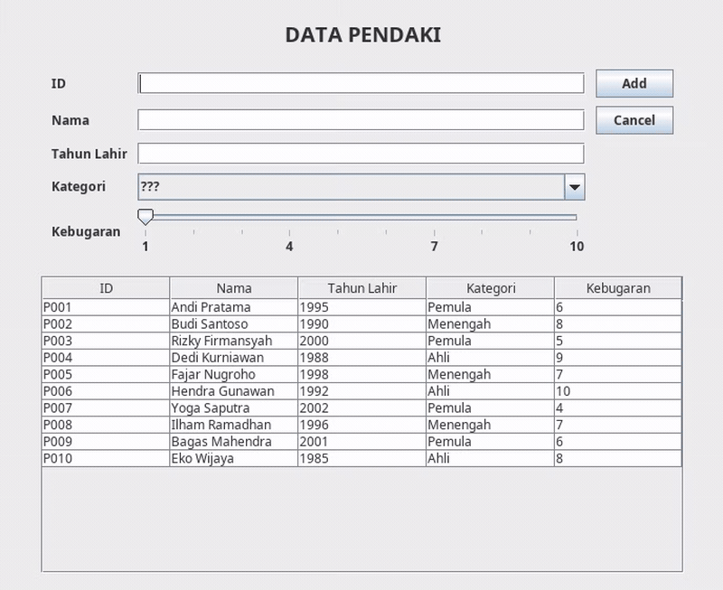

## ADD
### 1. Insert Berhasil

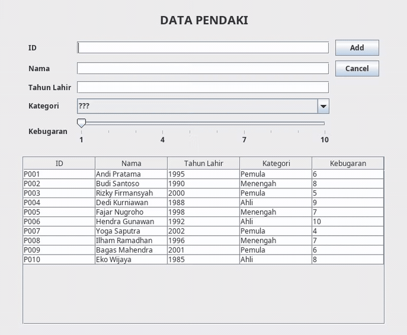

### 2. Input ID/Nama/Tahun Lahir Kosong

| ID kosong | Nama kosong |
| :---: | :---: |
| 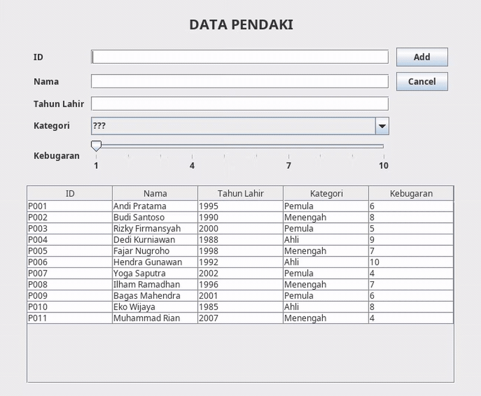 | 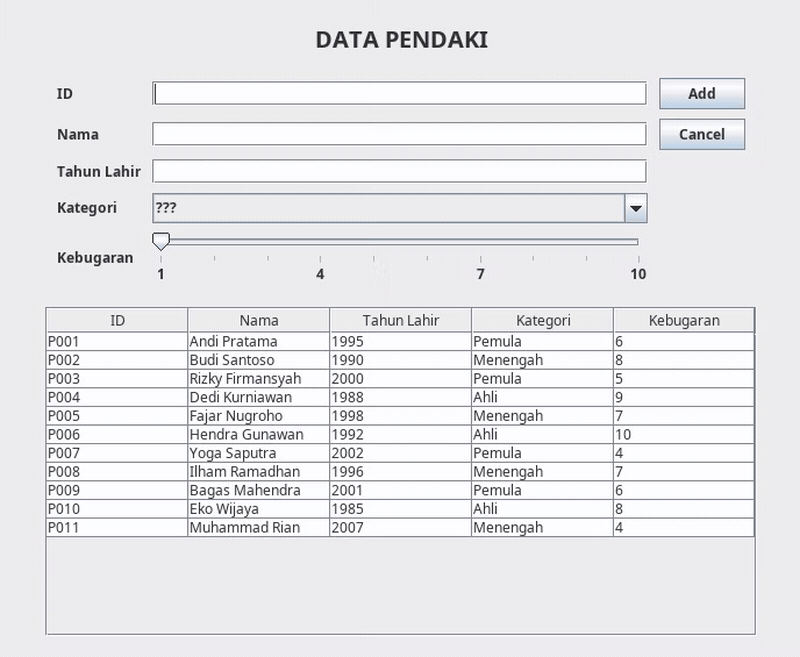 |

| Tahun Lahir kosong |
| :---: |
| 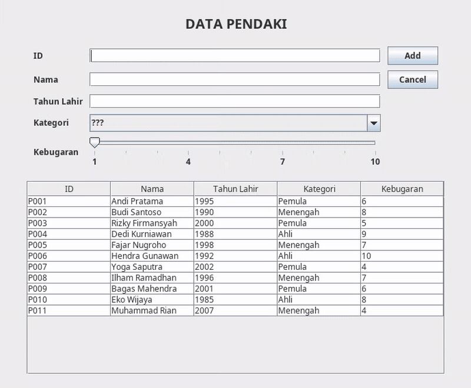 |

### 3. Kategori Kosong

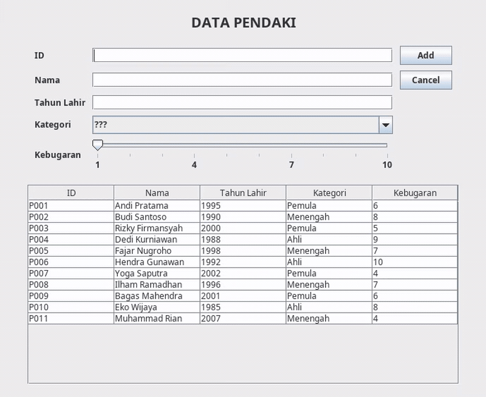

### 4. Tahun Bukan Angka

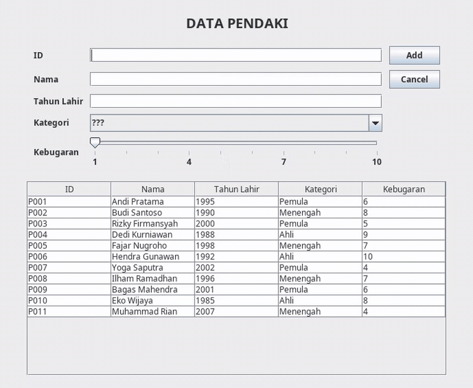

## UPDATE
### 1. Update Berhasil

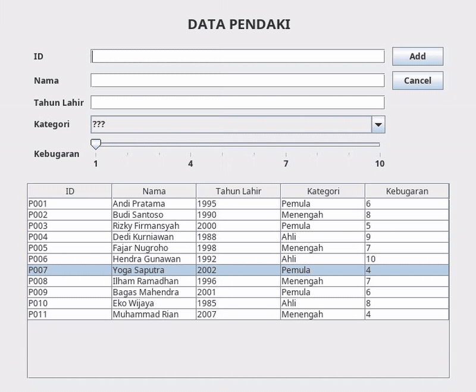

### 2. Input ID/Nama/Tahun Lahir Kosong

| ID kosong | Nama kosong |
| :---: | :---: |
| 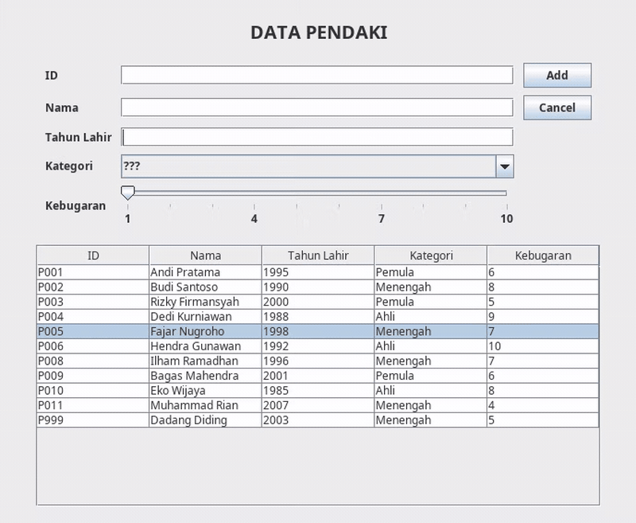 | 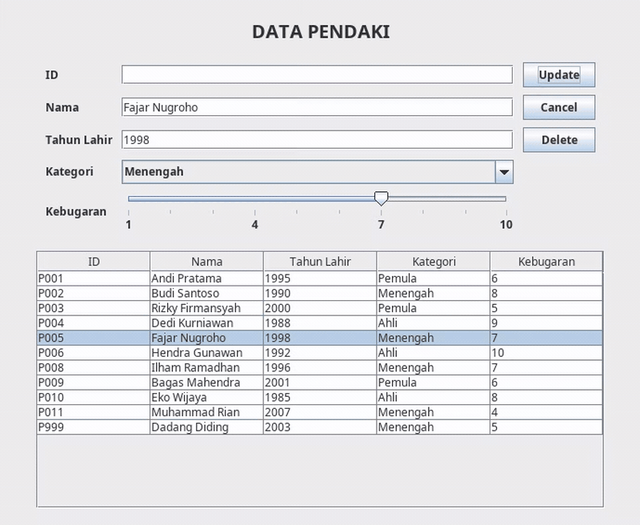 |

| Tahun Lahir kosong |
| :---: |
| 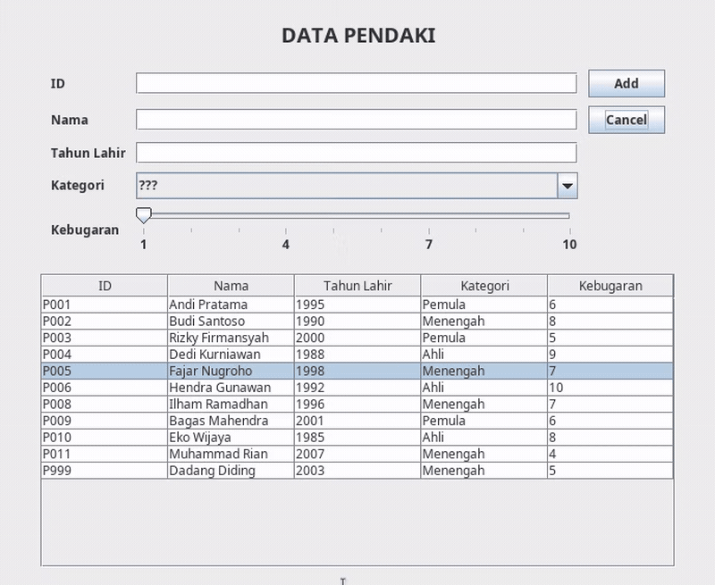 |

### 3. Kategori Kosong

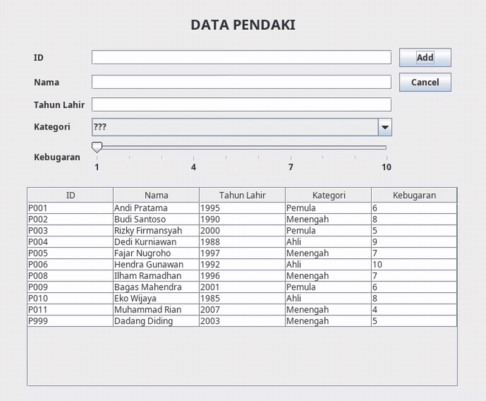

### 4. Tahun Bukan Angka

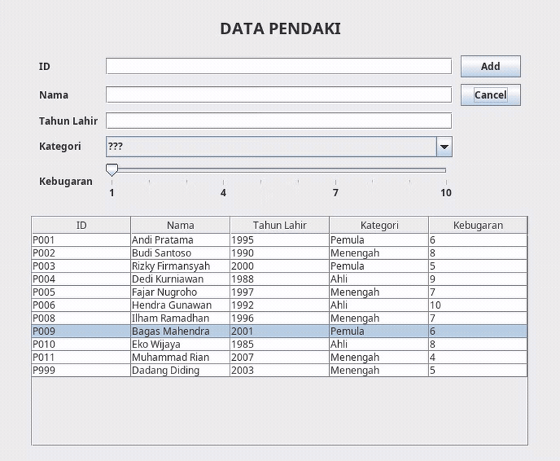

## ID SUDAH DIGUNAKAN SAAT INSERT/UPDATE

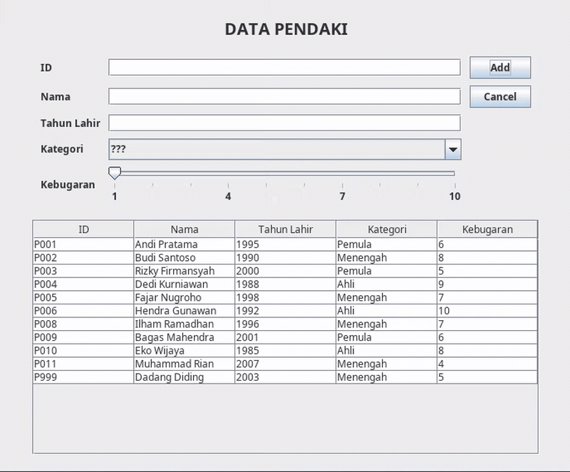

## DELETE
### Delete Berhasil

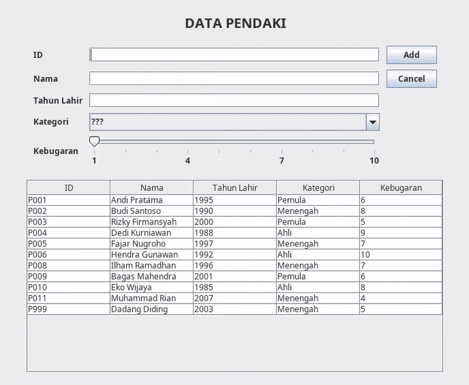

### Delete Dibatalkan

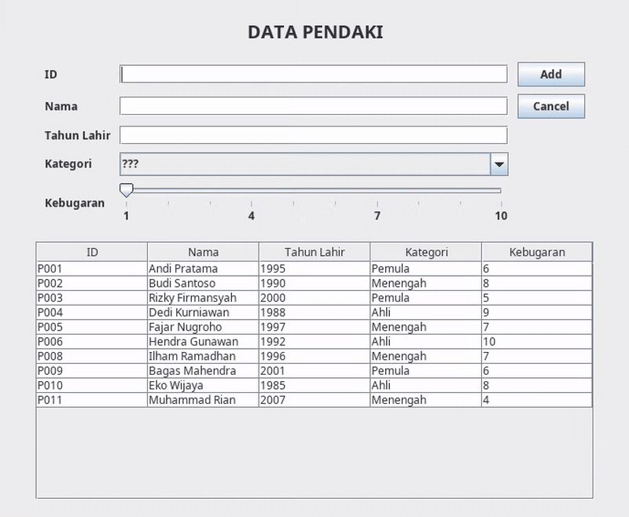
